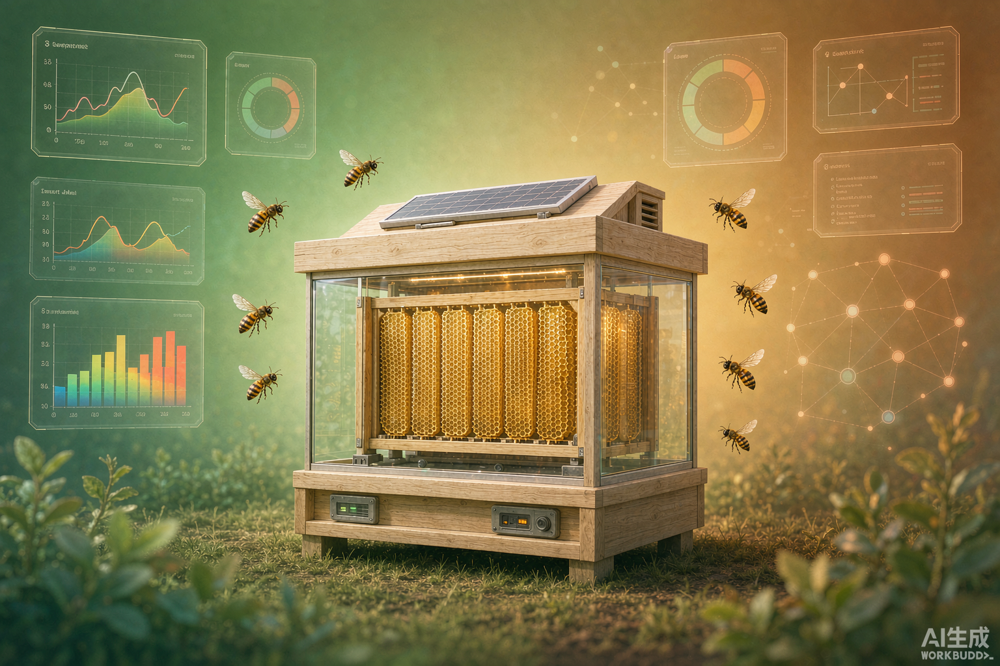
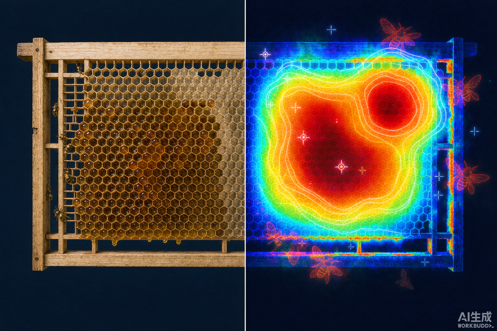

<div align="center">



# 🐝 智能蜂箱 · 养蜂学数字化教学观测台

**让蜂群行为"看得见、讲得清、可干预"**

> 一个为**宜春学院动物科学专业《养蜂学》授课项目**服务的三维虚拟实训平台

[](https://www.gnu.org/licenses/agpl-3.0)
[](https://github.com/zhangruixin27)
[](https://github.com/zhangruixin27)
[](https://github.com/zhangruixin27)

</div>

---

## 📖 为什么做这个项目？

《养蜂学》是动物科学专业的特色课程，但传统教学面临**三重困境**：

| 😣 教学痛点 | 🚀 我们的解法 |
|---|---|
| 蜂群行为观察、分蜂处理受**季节、场地、安全**制约，学生难以动手 | 三维虚拟蜂箱 + 真实作业参数的巡检动画，**全年随时可教可学** |
| 地域性养蜂案例难获取，教学内容与产业前沿脱节 | 内嵌真实比例模型、飞行路径、热成像等**多模态教学素材** |
| 考核以纸笔为主，缺乏实操与伦理决策评价 | **数字福利评分 + 自然语言干预**，让"做中学、评中思"落地 |

本项目源于**生成式 AI 赋能新农科应用型人才培养**的教改实践，将「内容生成—方法融合—评价智能—实践闭环」四维教学模式，落到一个可交互的三维课堂界面中。

---

## ✨ 核心功能一览

<table>
  <tr>
    <td width="50%" valign="top">
      <h3>🐝 三维蜂箱巡检</h3>
      <ul>
        <li><b>真实作业参数</b>：上层箱体抬升 400 mm、巢框提起约 300 mm，与养蜂实操一致</li>
        <li><b>全链路动画</b>：抬箱 → 逐框拎脾 → 合箱，检修门开合双动画</li>
        <li><b>交互控制</b>：自动/手动巡检、暂停、归位、蜂王脾聚焦</li>
        <li><b>多视角</b>：真实比例 ×1 与示意放大 ×2/×3、剖视/原版、内部特写、全景</li>
        <li><b>可替换模型</b>：支持加载自有 <code>.glb</code> 蜂箱</li>
      </ul>
    </td>
    <td width="50%" valign="top">
      <h3>🌡️ 热成像识别（快捷键 T）</h3>
      <ul>
        <li><b>全箱热场伪彩</b>：巢脾温度分布直观呈现</li>
        <li><b>三型蜂与幼虫识别</b>：蜂王/工蜂/雄蜂随动识别框，点击查看知识点</li>
        <li><b>数字福利评估</b>：巢温、存活率、蜜产量、伦理积分多维评分</li>
        <li><b>自然语言干预</b>：输入"通风降温""应急保温"，观察指标联动</li>
      </ul>
    </td>
  </tr>
  <tr>
    <td width="50%" valign="top">
      <h3>🔬 沉浸式剖视实验</h3>
      <ul>
        <li><code>lab.html</code> 提供逐级开箱、拎脾、蜂种辨识的引导式实验</li>
        <li>悬浮 HUD 实时提示当前层级与部件知识点</li>
        <li>适合课堂引导教学与课后自主探究</li>
      </ul>
    </td>
    <td width="50%" valign="top">
      <h3>📄 配套教学材料</h3>
      <ul>
        <li><code>操作.docx</code>：本地部署与课堂流程</li>
        <li>教改论文：教学设计依据与评价框架</li>
        <li>全部素材随仓库开源，可直接用于授课</li>
      </ul>
    </td>
  </tr>
</table>

---

## 🔥 功能展示：热成像识别



> 左：可见光下的巢脾；右：热成像伪彩视图，红/黄热点对应幼虫聚集区，配合识别框与福利评估——这正是课堂主线中「识别 → 解释 → 干预」环节的核心工具。

---

## 🚀 快速开始

**无需 npm、无需构建**，纯静态页面，开箱即用。

### 方式一：本地 HTTP 服务器（推荐）

```bash
# 在项目根目录执行
python -m http.server 8000 --bind 127.0.0.1
```

浏览器打开：

```
http://127.0.0.1:8000/index.html?showcase=1&v=4
```

### 方式二：直接双击打开

双击 `index.html` 即可运行（蜂箱模型已内嵌为 JS 数据）。CDN 资源（three.js、蜜蜂模型）需联网加载。

> 💡 **运行环境**：现代浏览器（Chrome / Edge / Firefox，需支持 WebGL 与 importmap）；Python 3（仅方式一需要）。

---

## 🎓 课堂主线：观察 → 识别 → 解释 → 干预

<div align="center">

| 环节 | 界面操作 | 教学目标 |
|:---:|:---|:---|
| **👀 观察** | 剖视/原版切换、比例缩放、全景与特写 | 建立蜂箱结构与巢脾空间认知 |
| **🔍 识别** | 巡检拎脾、蜂王脾聚焦、三型蜂识别、热成像 | 掌握蜂种辨识与温度分布特征 |
| **📚 解释** | 点击蜂体/部件弹出知识点卡片 | 理解蜂群行为、封盖、守卫检查等知识 |
| **🎯 干预** | 自然语言调节通风/保温、数字福利评估 | 建立蜂群福利与伦理决策意识 |

</div>

---

## 📁 项目结构

```
智能蜂箱/
├── 🐝 index.html          # 主教学观测台：三维蜂箱 + 热成像 + 干预评价
├── 🔬 lab.html            # 沉浸式剖视实验页（构建产物，勿直接编辑）
├── 🧱 hive-model.js       # 蜂箱建模模块（源自 Gratheon/robotic-beehive）
├── 💾 hive-tower-data.js  # 蜂箱 GLB 原始字节内嵌数据
├── 🖼️ assets/             # 封面、热成像示意、贴图等配图资源
├── 📋 操作.docx           # 本地部署与课堂操作流程
├── 📄 生成式AI技术……以养蜂学课程为例.docx  # 教改论文
├── 📖 README.md           # 本文件
├── ⚖️ LICENSE             # GNU AGPL-3.0 许可证
├── 📢 NOTICE.md           # 第三方资源声明
├── 🤝 CONTRIBUTING.md     # 贡献指南
└── 📜 CODE_OF_CONDUCT.md  # 行为准则
```

---

## 🤝 贡献指南

欢迎讲师、同学与开发者参与改进！提交前请阅读 [CONTRIBUTING.md](CONTRIBUTING.md) 与 [CODE_OF_CONDUCT.md](CODE_OF_CONDUCT.md)。

> ⚠️ `lab.html` 为构建产物请勿直接编辑；涉及第三方模型的改动请同步更新 [NOTICE.md](NOTICE.md)。

---

## ⚖️ 许可与第三方声明

本项目整体采用 **[GNU AGPL-3.0](LICENSE)** 授权。

**为何是 AGPL-3.0 而非 MIT？** 核心蜂箱模型源自 [Gratheon/robotic-beehive](https://github.com/Gratheon/robotic-beehive)（AGPL-3.0），本项目对其建模逻辑未作实质修改。为尊重上游 copyleft 要求、保持合规一致，项目统一采用 AGPL-3.0。

| 资源 | 来源 | 授权 |
|:---|:---|:---|
| 蜂箱模型 | [Gratheon/robotic-beehive](https://github.com/Gratheon/robotic-beehive) | AGPL-3.0 |
| 蜜蜂模型 | [Polyfork](https://polyfork.dev/asset/honeybee-base) | CDN 热链接，源码不分发 |
| three.js | [unpkg](https://unpkg.com/three@0.180.0/) | MIT |

完整说明见 [NOTICE.md](NOTICE.md)。

---

## 🙏 致谢

<div align="center">

| 角色 | 贡献者 |
|:---|:---|
| **作者 / 教学设计** | **李震 博士**（宜春学院《养蜂学》课程） |
| 设计制作 | 李震 · 李扬帆 · 张瑞馨 |
| 项目维护 | [@zhangruixin27](https://github.com/zhangruixin27) |
| 蜂箱模型 | [Gratheon](https://github.com/Gratheon/robotic-beehive) |
| 蜜蜂模型 | [Polyfork](https://polyfork.dev/) |
| 教学应用 | 宜春学院动物科学专业《养蜂学》课程组 |

---

**为《养蜂学》课堂而造 · 以 AGPL-3.0 开源 · 欢迎教育与学术用途** 🐝

</div>
